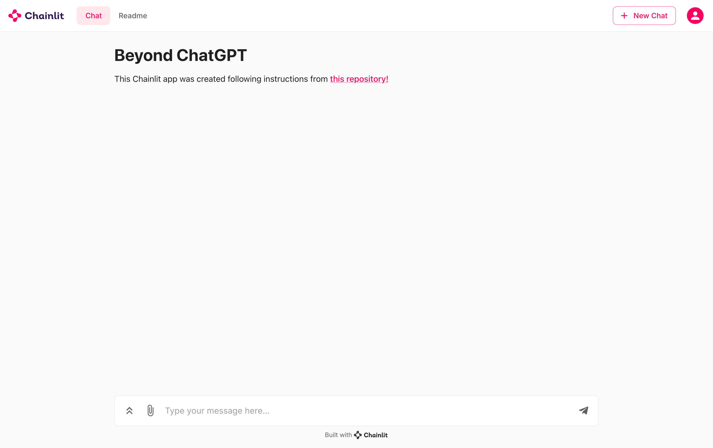
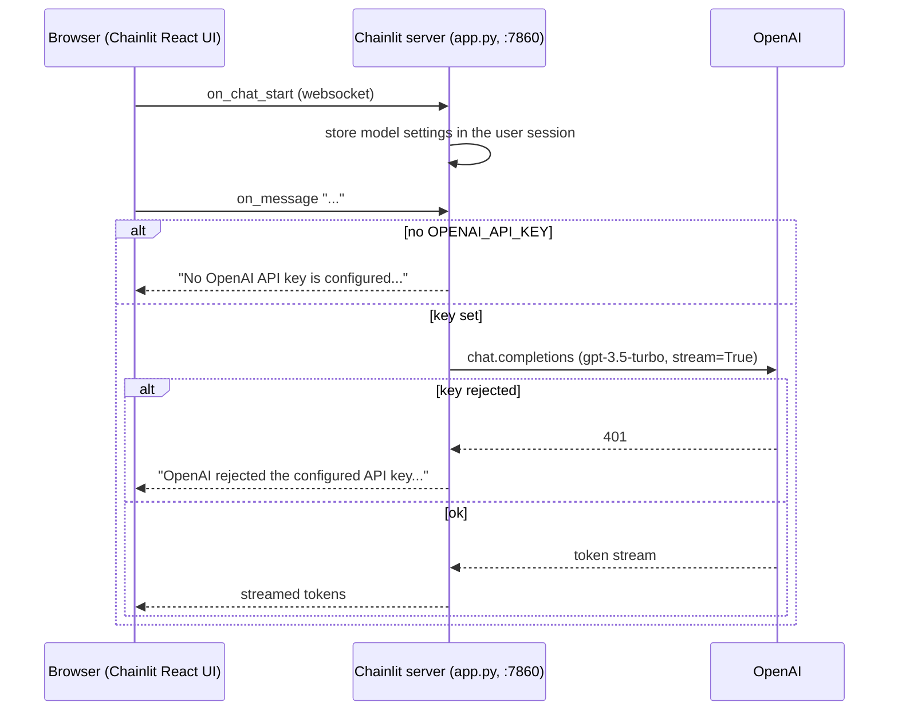
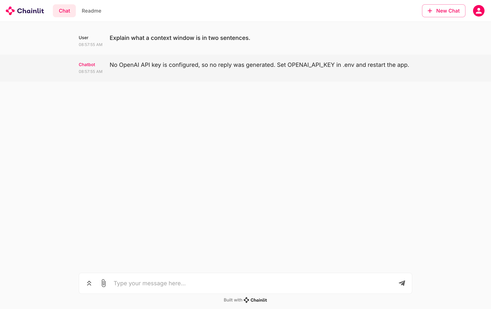
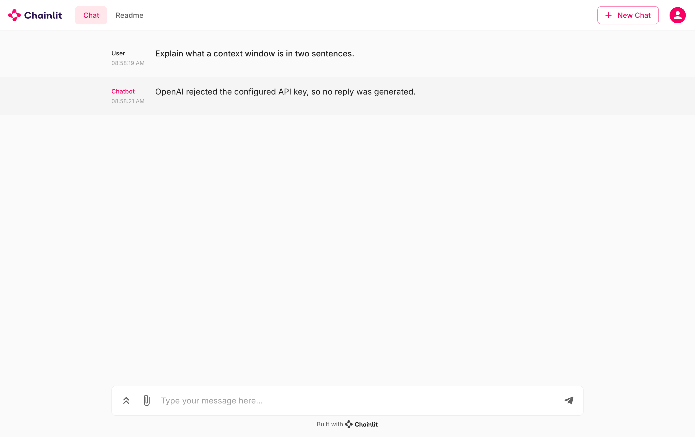

# LLM Chainlit Chat

**A small streaming chatbot: Chainlit's React chat UI in front of OpenAI GPT-3.5 Turbo.**

It answers in a pleasant tone and thinks step by step. Everything is one `app.py`, about 100 lines. There is also a live demo on [Hugging Face Spaces](https://huggingface.co/spaces/ovokpus/llm-app).



---

## 1. Why it exists

It's a minimal, readable starting point for an LLM chat app. Chainlit provides the chat frontend (a React app shipped inside the Python package), streaming and sessions, so the code is only prompt templates plus one OpenAI call.

## 2. How it works



## 3. Run it locally

```bash
cp .env.example .env              # put your OPENAI_API_KEY in .env
docker compose up -d --build --wait
open http://localhost:7860
docker compose down
```

The first build takes a few minutes: the image installs Rust so `tiktoken` 0.5.1 can compile on Python 3.13.

## 4. Screens

| State | Screenshot |
| --- | --- |
| Welcome |  |
| Message sent with **no key**: the app says no reply was generated |  |
| Message sent with an **obviously fake key**: OpenAI returns 401 and the app says so |  |

### Model-dependent screen: not run

No real OpenAI key was used, so **no model reply was generated or captured**. With a valid key, the chatbot message streams GPT-3.5 Turbo's answer token by token.

## 5. Tests and CI

```bash
docker compose build
docker compose run --rm --no-deps -e OPENAI_API_KEY= app uv run --with pytest pytest -q tests
```

`tests/test_offline.py` calls the Chainlit handler directly with stubbed messages. It checks the key detection, the no-key reply and the prompt templates, with no network. CI builds the image and runs the tests inside it, because `tiktoken` needs the Rust toolchain that the image installs.

Regenerate the screenshots with the app running (`no-key` or `rejected-key`):

```bash
uv run --no-project --with playwright python scripts/screenshots.py no-key
```

## 6. What changed for local use

- `docker-compose.yml`, `.env.example` (empty key), `.dockerignore` (keeps `.env` and the notebooks out of the image).
- Honest key states in `app.py`: a clear message when no key is set or OpenAI rejects it, instead of an exception.
- The existing `Dockerfile` (used by Hugging Face Spaces) is unchanged.

---

The original README (Chainlit intro, notes) is in [`docs/ORIGINAL_README.md`](docs/ORIGINAL_README.md). The course notebooks are in `notebooks/`.
